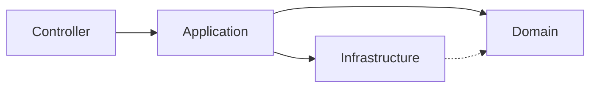

<p align="center">
  
</p>

<p align="center">
  <a href="https://github.com/devmauro107">
    
  </a>
</p>

<p align="center">
  <a href="https://linkedin.com/in/SEU_LINKEDIN"></a>
  <a href="mailto:SEU_EMAIL"></a>
  <a href="https://github.com/devmauro107?tab=repositories"></a>
</p>

<p align="center">
  
  
</p>

<p align="center">
  
  
  
</p>

---

## 👨‍💻 Sobre mim

```java
public class MauroSergio {

    private final String formacao   = "Sistemas para Internet - UNIESP";
    private final String foco       = "Desenvolvimento Back-end";
    private final String[] stack    = {"Java", "Spring Boot", "PostgreSQL", "Docker"};
    private final String[] praticas = {"Clean Architecture", "DDD", "API REST", "Flyway"};
    private final String objetivo   = "Construir sistemas escaláveis e de fácil manutenção";

    public String lema() {
        return "Aprender na prática, documentar e evoluir a cada projeto.";
    }
}
```

Sou estudante de **Sistemas para Internet** na UNIESP e direciono meus estudos para o **Back-end**, com ênfase em **Java, Spring Boot, Clean Architecture e Domain-Driven Design**. Complemento minha base com **React, TypeScript e Vite** para compreender o fluxo completo de uma aplicação Full Stack.

<table>
  <tr>
    <td>🎯 <b>Objetivo</b></td>
    <td>Atuar como desenvolvedor Back-end</td>
  </tr>
  <tr>
    <td>📚 <b>Estudando agora</b></td>
    <td>Arquitetura de software, padrões de projeto e boas práticas de API</td>
  </tr>
  <tr>
    <td>🛠️ <b>Abordagem</b></td>
    <td>Cada estudo vira um projeto estruturado e documentado</td>
  </tr>
  <tr>
    <td>🤝 <b>Aberto a</b></td>
    <td>Estágios, vagas júnior e colaboração em projetos open source</td>
  </tr>
</table>

---

## ⚡ Stack & Ferramentas

<p align="center">
  
</p>
<p align="center">
  
</p>

<details>
<summary><b>📋 Ver detalhes por categoria</b></summary>
<br>

| Categoria | Tecnologias |
|-----------|-------------|
| ☕ **Back-end** | Java · Spring Boot · Spring Data JPA · Hibernate · Maven · Swagger/OpenAPI |
| 🏛️ **Arquitetura** | Clean Architecture · DDD · Arquitetura em camadas · API REST |
| 🗄️ **Dados** | PostgreSQL · MySQL · SQL · Flyway (migrações) |
| 🌐 **Front-end** | React · TypeScript · JavaScript · HTML5 · CSS3 · Vite |
| 🐳 **DevOps & Ferramentas** | Docker · Git · GitHub · IntelliJ IDEA · DataGrip |

</details>

---

## 🏛️ Como estruturo meus projetos



> **Controller:** API REST · **Application:** casos de uso · **Domain:** entidades e regras de negócio · **Infrastructure:** JPA e PostgreSQL.
> O domínio fica isolado de frameworks e banco de dados; as dependências apontam sempre para dentro.

---

## 🚀 Projetos em destaque

<table>
  <tr>
    <td width="50%" valign="top">
      <h3>🛠️ Assistência Técnica API</h3>
      <p>API REST para gerenciamento de assistência técnica, com arquitetura em camadas, persistência relacional e migrações versionadas.</p>
      <ul>
        <li>CRUD completo com validações</li>
        <li>Mapeamento ORM com JPA/Hibernate</li>
        <li>Versionamento de banco com Flyway</li>
      </ul>
      <p>
        
        
        
        
        
      </p>
      <!-- Troque o link abaixo pelo repositório: https://github.com/devmauro107/NOME_DO_REPOSITORIO -->
      <a href="https://github.com/devmauro107?tab=repositories"><b>Ver repositório →</b></a>
    </td>
    <td width="50%" valign="top">
      <h3>🍽️ RestaurantBlue</h3>
      <p>Projeto acadêmico para gerenciamento de pedidos de restaurante, com API REST documentada via Swagger.</p>
      <ul>
        <li>Gestão de pedidos ponta a ponta</li>
        <li>Documentação interativa com Swagger</li>
        <li>Organização em camadas</li>
      </ul>
      <p>
        
        
        
        
      </p>
      <!-- Troque o link abaixo pelo repositório: https://github.com/devmauro107/RestaurantBlue -->
      <a href="https://github.com/devmauro107?tab=repositories"><b>Ver repositório →</b></a>
    </td>
  </tr>
</table>

---

## 🗺️ Roadmap de estudos

- [x] Java e Orientação a Objetos
- [x] Spring Boot + API REST
- [x] JPA / Hibernate + PostgreSQL + Flyway
- [ ] Clean Architecture e DDD aplicados em projeto completo
- [ ] Docker e Docker Compose
- [ ] Testes automatizados (JUnit e Mockito)
- [ ] Spring Security + JWT
- [ ] CI/CD com GitHub Actions

---

## 📈 Estatísticas

<p align="center">
  
  
  
</p>

---

## 📬 Vamos conversar?

<p align="center">
  
</p>

<p align="center">
  <a href="https://linkedin.com/in/SEU_LINKEDIN"></a>
  <a href="mailto:SEU_EMAIL"></a>
  <a href="https://github.com/devmauro107"></a>
</p>

<p align="center">
  <sub>⭐ Gostou de algum projeto? Deixe uma estrela no repositório!</sub>
</p>

<p align="center">
  
</p>
